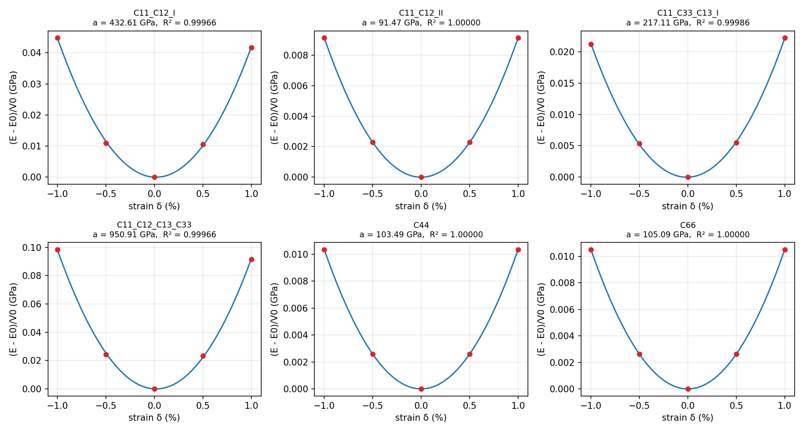

Step by step: rutile TiO₂
=========================

This example goes through a complete calculation and shows what you see at every step. Rutile
is tetragonal, with 6 atoms that move when the cell is strained. The calculator is the
machine-learning potential GRACE-2L-OAM (``pip install tensorpotential``); with any other ASE
calculator only step 2 changes.

Step 1 – Build the structure and check its symmetry
---------------------------------------------------

.. code-block:: python

   from ase.spacegroup import crystal
   from elastic_ase import check_symmetry

   atoms = crystal(["Ti", "O"], [(0, 0, 0), (0.305, 0.305, 0)], spacegroup=136,
                   cellpar=[4.594, 4.594, 2.959, 90, 90, 90])
   check_symmetry(atoms)

.. code-block:: text

   Atoms(O4Ti2): O4Ti2 (6 atoms)
   Space group:        P4_2/mnm (136) – tetragonal I (Laue class 4/mmm), spglib symprec = 0.001 Å
   Elastic constants:  6 independent (C11, C12, C13, C33, C44, C66 in this orientation)
   Recommended:        symmetry='tetragonal_1' (6 deformations) – works in this orientation
   Also works:         tetragonal_2 (7), orthogonal (9), monoclinic (13), triclinic (21)
   Any orientation:    symmetry='auto' – 6 deformations

This tells you, before any calculation, which **method** will be used: rutile has 6 independent
elastic constants, measured with the ``tetragonal_1`` table of 6 deformations. Your own
structure can come from any file: ``atoms = ase.io.read("POSCAR")`` (or a CIF, …).

Step 2 – Attach the calculator and relax the structure
------------------------------------------------------

.. code-block:: python

   from ase.filters import FrechetCellFilter
   from ase.optimize import BFGS
   from tensorpotential.calculator import grace_fm

   atoms.calc = grace_fm("GRACE-2L-OAM")
   BFGS(FrechetCellFilter(atoms)).run(fmax=1e-4)  # cell and atoms

The method needs a **stress-free** reference: a cell left under stress biases the constants,
by several times that stress (:ref:`residual-stress`).

Step 3 – Set up the calculation
-------------------------------

.. code-block:: python

   from elastic_ase import ElasticConstants

   ec = ElasticConstants(atoms, fmax=1e-4)
   print(len(ec.runs()))

.. code-block:: text

   [ElasticASE] Auto-detected crystal symmetry: 'tetragonal_1'
   25

Each of the 6 deformations is applied at the strains −1, −0.5, +0.5 and +1 %; with the
unstrained cell that makes 25 energies. When the cell is strained, the atoms of a multi-atom
cell generally move to new positions (internal relaxation – the oxygen atoms here, but also
the atoms of diamond Si or hcp Mg under shear). elastic_ase therefore relaxes the atoms inside
every strained cell (``relaxation=True``, the default; BFGS until the forces are below
``fmax``) and gives the *relaxed-ion* constants, the ones that compare with experiment. With
``relaxation=False`` the atoms keep their scaled positions (*clamped-ion* constants).

Step 4 – Calculate
------------------

.. code-block:: python

   results = ec.calculate()

The report shows every fitted curvature, the stiffness matrix and the derived quantities
(shortened here):

.. code-block:: text

   Calculations           : 25 (including the unstrained cell)
   Atom relaxation        : on (BFGS, fmax = 0.0001 eV/Å; relaxed-ion constants)
     Mode C11_C12_I          -> Coeff =     432.61 GPa  (R² = 0.999665)
     Mode C11_C12_II         -> Coeff =      91.47 GPa  (R² = 0.999999)
     Mode C11_C33_C13_I      -> Coeff =     217.11 GPa  (R² = 0.999863)
     Mode C11_C12_C13_C33    -> Coeff =     950.91 GPa  (R² = 0.999660)
     Mode C44                -> Coeff =     103.49 GPa  (R² = 1.000000)
     Mode C66                -> Coeff =     105.09 GPa  (R² = 1.000000)

    6x6 Stiffness Matrix C_ij (GPa) [Cartesian Frame]:
           C1      C2      C3      C4      C5      C6
   C1  262.04  170.57  144.07    0.00    0.00    0.00
   C2  170.57  262.04  144.07    0.00    0.00    0.00
   C3  144.07  144.07  460.32    0.00    0.00    0.00
   C4    0.00    0.00    0.00  103.49    0.00    0.00
   C5    0.00    0.00    0.00    0.00  103.49    0.00
   C6    0.00    0.00    0.00    0.00    0.00  210.17

     Status   : MECHANICALLY STABLE
     Bulk Modulus K_VRH   :   207.09 GPa  (Voigt: 211.31, Reuss: 202.87)
     Shear Modulus G_VRH  :   105.54 GPa  (Voigt: 118.48, Reuss: 92.61)
     Debye temperature    :    760.8 K  (Anderson)
     Residual pressure    :    -0.00 GPa  (from the fits; should be ~0)

Each "Coeff" is the curvature of one energy–strain curve, a known combination of elastic
constants (listed for every deformation in :doc:`../systems`); the 6 curvatures are
solved for the 6 constants (:doc:`../theory`).

Step 5 – Check the result
-------------------------

.. code-block:: python

   ec.plot_fits("rutile_tio2_fits.png")

   One panel per deformation: the computed energies (points) and the fitted parabola.

Before using the numbers, check three things:

* **The curves** are smooth parabolas through every point. Scatter means unconverged
  calculator settings, a single point off the curve a failed calculation.
* **The residual pressure** is close to zero (here 0.00 GPa). A large value means the
  structure was not relaxed with the same calculator and settings.
* **Stability**: "MECHANICALLY STABLE" (all eigenvalues of C positive).

Step 6 – Use and save the results
---------------------------------

.. code-block:: python

   results.standard_constants          # C11 ≈ 262.0, C12 ≈ 170.6, C13 ≈ 144.1, ... (GPa)
   results.polycrystalline_averages["K_VRH"]
   ec.save("rutile.json")              # structure, settings, every energy, results
   ec.export_matrix("C.txt")           # plain 6x6 matrix

Every field of the results is described in :doc:`../guide/results`; the measured constants
of rutile are compared in :doc:`../testing`.

The whole calculation as one script: :download:`rutile_tio2.py <scripts/rutile_tio2.py>`.

Next
----

* The same steps for every crystal symmetry: :doc:`laue`.
* Other calculators, including DFT: :doc:`calculators` and :doc:`../guide/dft`.
